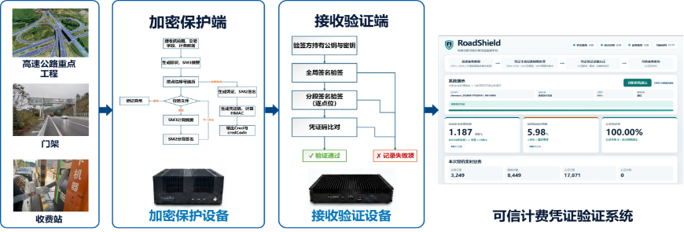
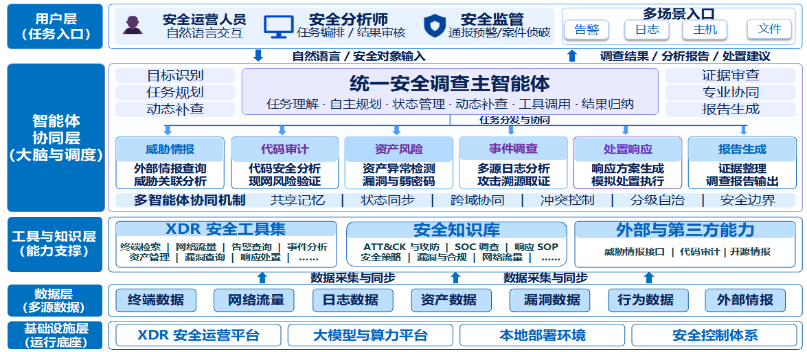

# Bingchen Liu · 刘柄辰

I’m an M.S. student in Cyberspace Security at Guizhou Normal University. My interests span AI security, agent security, software security, and trustworthy systems.

我目前在贵州师范大学攻读网络空间安全硕士学位，关注人工智能安全、智能体安全、软件安全与可信系统。

[Academic homepage](https://zxx122h.github.io/zxx122h/)

## Education / 教育经历

###  Guizhou Normal University · 贵州师范大学

**M.S. student in Cyberspace Security** · Sep 2025–Present 
网络空间安全硕士研究生 · 2025 年 9 月至今

First-Class Scholarship, 2025–2026 
2025–2026 学年一等奖学金

*“Just a juruo from a non–Double First-Class university, working toward a Ph.D.”*

###  Nanjing Tech University · 南京工业大学

**B.S. in Computer Science and Technology** · Sep 2020–Jun 2024 
计算机科学与技术本科 · 2020 年 9 月–2024 年 6 月

Special-Category Scholarship and annual recognition for outstanding individual contribution to social practice. 
南京工业大学单项奖学金、年度社会实践先进个人。

CET-4: 573 · CET-6: 445 · Spoken English: Grade B 
英语四级 573 · 英语六级 445 · 口语 B

*“Fingers crossed that my alma mater joins China's Double First-Class initiative someday.”*

## Selected Projects / 项目经历

### RoadShield

Contributed to cryptographic engineering and trustworthy data processing for transportation billing credentials. 
参与智能交通计费凭证相关的密码工程与可信数据处理。

### Multi-Agent Security Investigation Platform

*Multi-Agent Collaborative Monitoring and Incident Response Platform Based on Multi-Source Security Data* 
基于多源安全数据的多智能体协同监测与应急响应平台

Helped develop an evidence-driven investigation workflow, including case state management and agent orchestration. 
参与平台的证据驱动调查流程开发，包括案件状态管理与智能体编排。

## Honors / 荣誉奖项

- **National First Prize** · 19th National College Student Information Security Competition and 3rd Great Wall Cup, Works Competition · 2026 
  第十九届全国大学生信息安全竞赛（作品赛）暨第三届“长城杯”网数智安全大赛（作品赛）全国一等奖
- **National Second Prize (Team)** · Software System Security Competition, 9th China University Intelligent Robot Creative Competition · 2026 
  第九届中国高校智能机器人创意大赛产教融合赛道·软件系统安全赛全国二等奖（团队）

<!-- Publications: add only verified published or accepted work. -->
